# RealEstate — SkyNet Real Estate Agency Template

A responsive website for a real estate agency: homes for sale and rent with search filters, a map view, photo galleries, a mortgage calculator, agent profiles and a full agent admin, built for **ASP.NET Core (.NET 10)** on the **SkyNet Framework**.
It is universal: rename the agency, set your neighborhoods, agents, mortgage defaults, office hours and time zone, and the whole site follows. Data is stored in JSON files, with no database.
Free and open source. **100% AI-driven coding — built by Claude.**

[](https://dotnet.microsoft.com/)
[](https://www.nuget.org/packages/TheSkyLite.SkyNet)
[](LICENSE)
[](#100-ai-driven-coding)

**Live demo:** https://www.theskylite.com/RealEstate

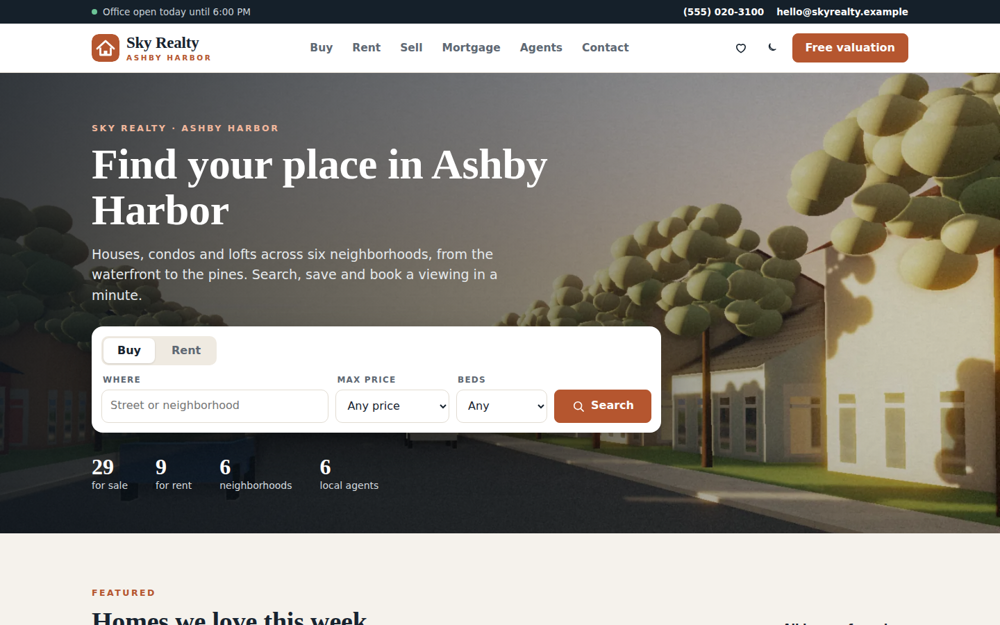

> **Fictional agency.** Sky Realty, the town of Ashby Harbor and every home, agent, price and address are invented. The house photos, interiors and portraits are painted in code; the town map is drawn in code. There are no stock images and no map service or API key.

---

## Features

### Agency website (8 pages)

- **Home:**
  - a hero with a **Buy / Rent** search (where, max price, beds) and live counts;
  - featured homes, the six neighborhoods with home counts and median prices, a map teaser with every live home;
  - a quick monthly-payment estimate, the team, the newest rentals and a **What is your home worth?** band.
- **Open now / closed now** bar on every page, worked out in the agency's own time zone.
- **Search (Listings):**
  - **Buy / Rent**, a text search (street, neighborhood or listing number), min and max price, beds and home type in the bar;
  - **More filters:** baths, size, neighborhoods, must-haves (garage, garden, pool, waterfront, fireplace, balcony, parking, in-unit laundry, home office), open houses only, homes under offer, recently sold or rented;
  - every filter shows as a chip you can remove; sort by newest, price, size or price per square foot; paging;
  - **List, Split or Map view.** On phones a floating **Map / List** button flips between them;
  - the URL keeps the search, so it can be bookmarked or shared.
- **Map:** the town map with a price pin for every result.
  - Drag to move, scroll or pinch to zoom; zoomed out, pins become dots.
  - Hover a card to light up its pin; click a pin for a photo card.
  - **Search this area** limits the results to what is on screen.
- **Saved homes:** a heart on every card and listing. Saved homes stay in the browser (no account), with a count in the header and their own page.
- **Listing:**
  - a five-photo gallery and a full-screen **lightbox** (arrow keys, swipe, thumbnails, captions);
  - price, estimated monthly cost, beds, baths, size, lot or HOA, **Save** and **Share**;
  - description, features, a facts table, open houses, a location map with the neighborhood, price history with the change in %;
  - **Monthly cost** calculator for homes for sale (price, down payment, rate, term; taxes, insurance and HOA included);
  - the listing agent with **Book a viewing** (day and time from the office's viewing hours) or **Ask a question**;
  - similar homes. Sold, rented and under-offer homes stay online with a note.
- **Mortgage:** monthly payment (principal and interest, property tax, insurance, HOA, mortgage insurance under 20% down) with a chart, totals, payoff date, a yearly principal/interest chart and schedule. **How much can I afford?** uses the 28/36 rule and links to homes in that price range.
- **Agents:** filter by neighborhood; each agent with listings and recent closings. **Agent** pages add the bio, license, languages, a message form, their homes and their track record.
- **Sell:** a valuation request form (address, neighborhood, type, size, timing). It is sent to the agent who covers that neighborhood. Plus the steps and asking prices by neighborhood.
- **Contact:** office details, hours, a map and a message form. **New listings by email** sign-up in every footer.
- **Light and dark theme.** Responsive layouts for desktop, tablet and phone.

### Agent admin (12 pages)

- **Sign in** with the sample account (filled in on the sign-in page) or your own password (PBKDF2). Failed attempts are throttled.
- **Dashboard:** homes for sale and rent, new leads, viewings today, page views and saves; today's viewings, the newest leads, what needs attention (drafts, few photos, long offers, open houses this week) and the most viewed homes.
- **Listings:** search, filters and paging. The editor has tabs:
  - **Details:** headline, address, neighborhood, sale or rent, type, style, price, beds, baths, size, lot, year, parking, HOA, tax, available date, agent, status, featured;
  - **Description** and features;
  - **Photos:** upload (resized in the browser), pick from the library, reorder, choose the cover;
  - **Map pin:** click the map where the home is;
  - **Open houses** and the **History** of price and status changes (added automatically when you save).
- **Leads:** every viewing request, question, valuation and message from the website (23 sample leads included). Status (New, Contacted, Viewing booked, Closed), assign to an agent (or **Take this lead**), notes, and **Book a viewing** straight from the lead.
- **Viewings:** grouped by day, filter by period, status and agent (11 sample viewings included). Book, edit, mark done or no-show, cancel with a reason, reopen. The same agent can't be booked twice at once.
- **Neighborhoods** and **Agents:** search, filter, add, edit, reorder, hide. Each agent can have a **sign-in** (user name, password, on/off), created right in the agent form. Agents get a photo (upload or pick), neighborhoods a colour, a picture and a label position on the map.
- **Settings:** agency details, accent colour, theme, the word for your agents (Agents, Realtors, Brokers...), website text, mortgage defaults, office hours, viewing length and window, time zone, 24-hour clock.
- **Users:** a permission matrix for each person, plus "is this person one of the agents?" and **only sees their own listings, leads and viewings**.
- **Activity log** and **My account.**
- **Every list** has a search box with suggestions as you type, filters and paging.

### Permissions

| Area | Rights | Extra right |
|---|---|---|
| Listings | View, Edit | **Publish** (status, featured, delete) |
| Leads | View, Edit | **Assign** (assign to anyone, delete) |
| Viewings | View, Edit | |
| Neighborhoods, Agents | View, Edit | |
| Activity log | View | |
| Users, Settings | office managers only | |

- **Agents are users.** A new agent sign-in starts with **Listings, Leads and Viewings (edit), Neighborhoods (view), own records only**. These are only defaults: the office manager can change any of them in Users, add other areas or make the person an office manager. An agent can also be office staff.
- **Own only:** a person linked to an agent profile can be limited to their own listings, viewings and leads (plus unassigned leads they can take).
- Without **Publish**, new listings stay drafts until someone with the right puts them live.
- The menu shows only the areas a person can see. Every check runs on the server; a refused request is written to the activity log.

### Sign in

| User name | Password | Role |
|---|---|---|
| `admin` | `SkyRealty2026` | Office manager, every area |
| `grace`, `marcus`, `priya`, `daniel`, `hannah`, `owen` | `Agent2026` | Agents with the default rights |

- The sign-in page fills in the office manager and lists the agent sign-ins below the button.
- Change the office manager's password in **My account**: the filled-in fields and the hint go away.
- Change the agents' passwords in **Agents** or **Users**, and add your own team.
- Deleting `data/staff.json` brings back the `admin` sign-in only.

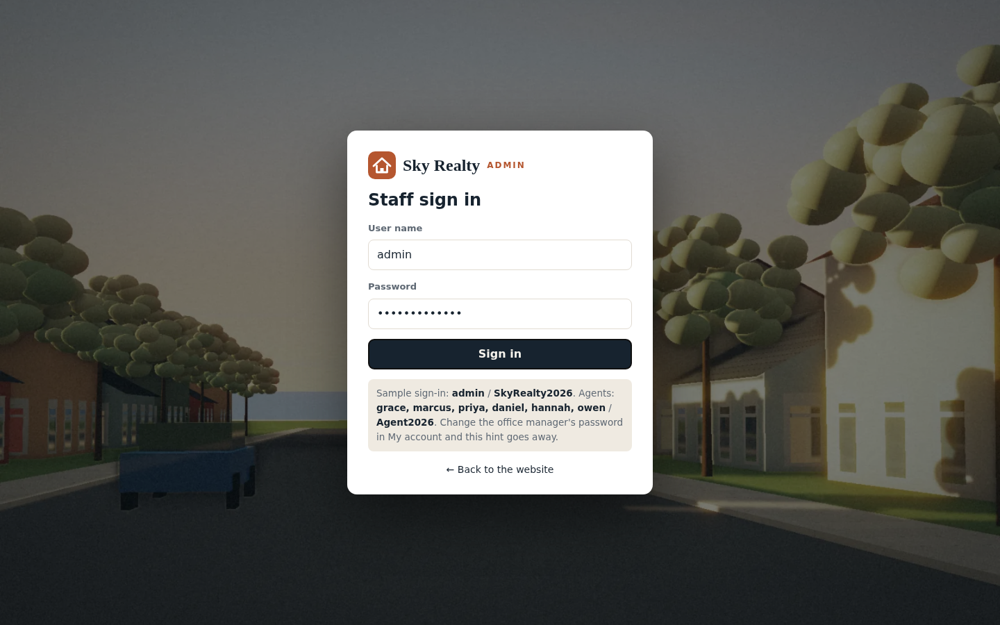

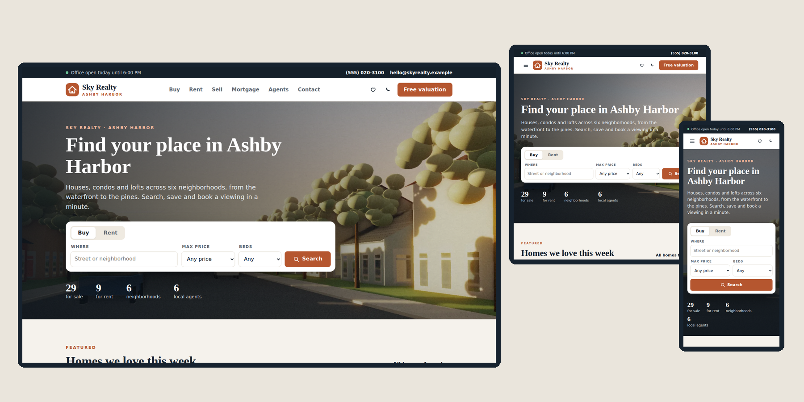

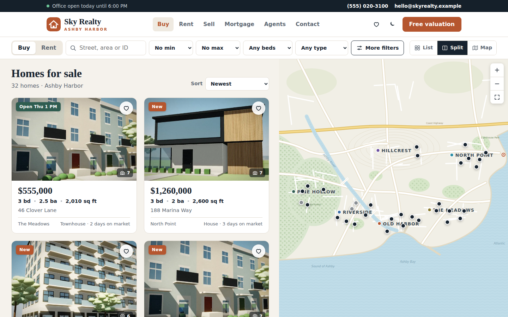

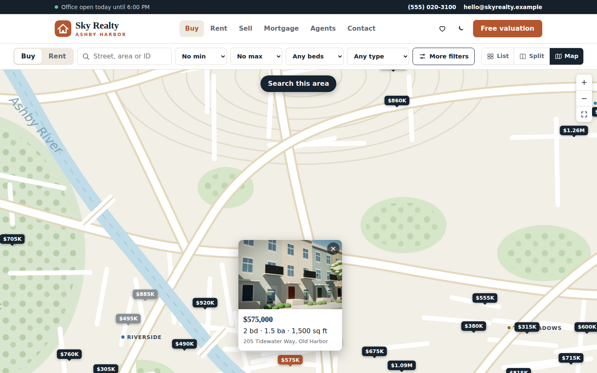

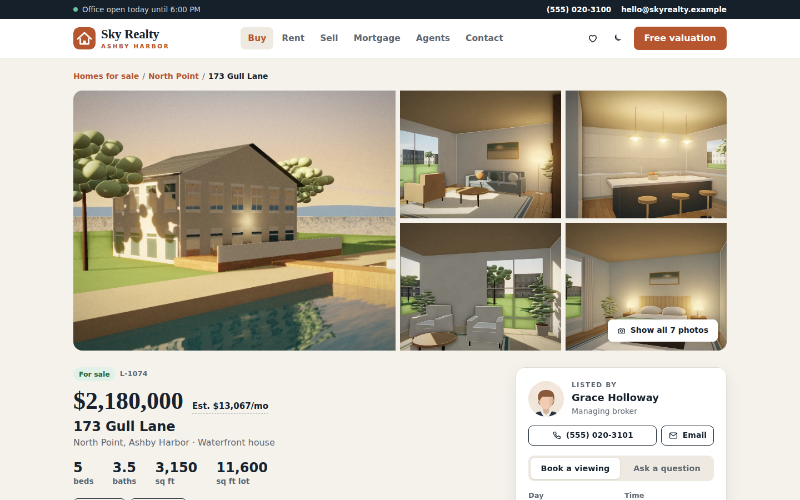

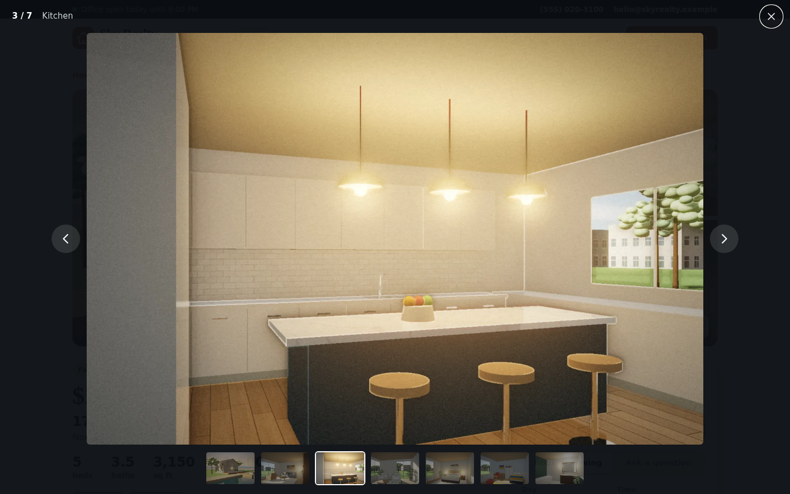

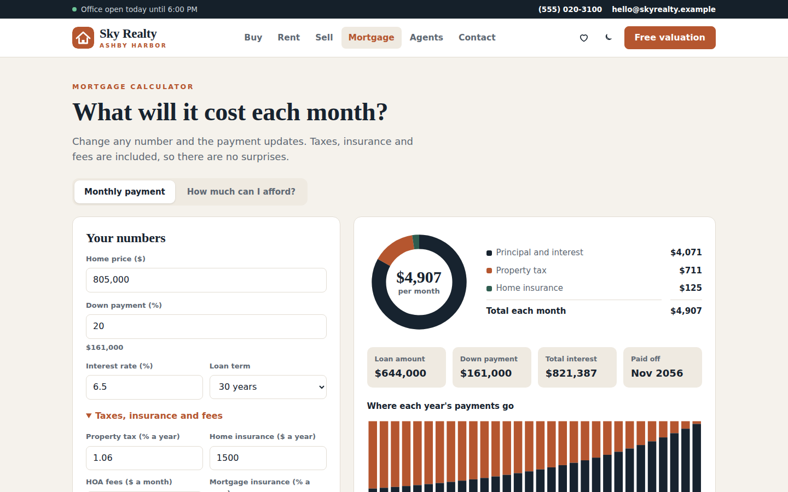

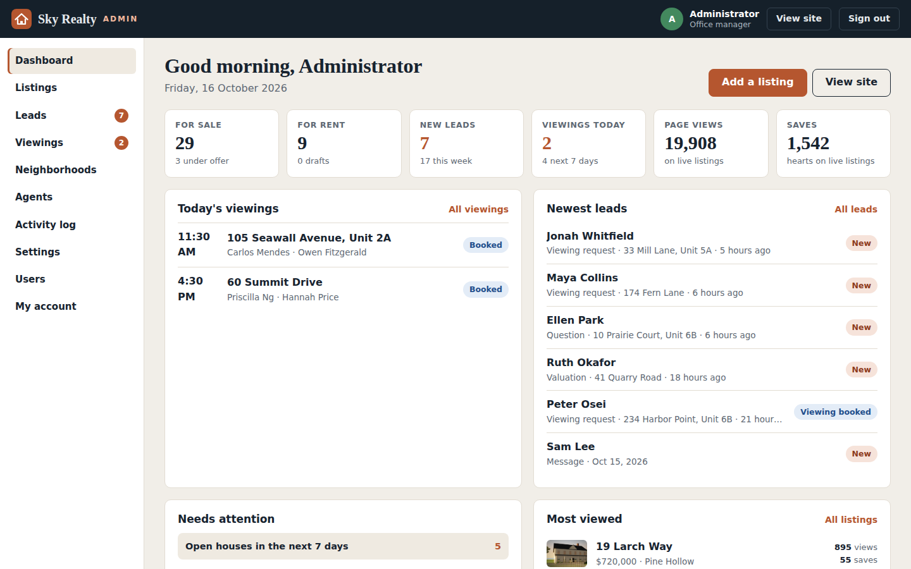

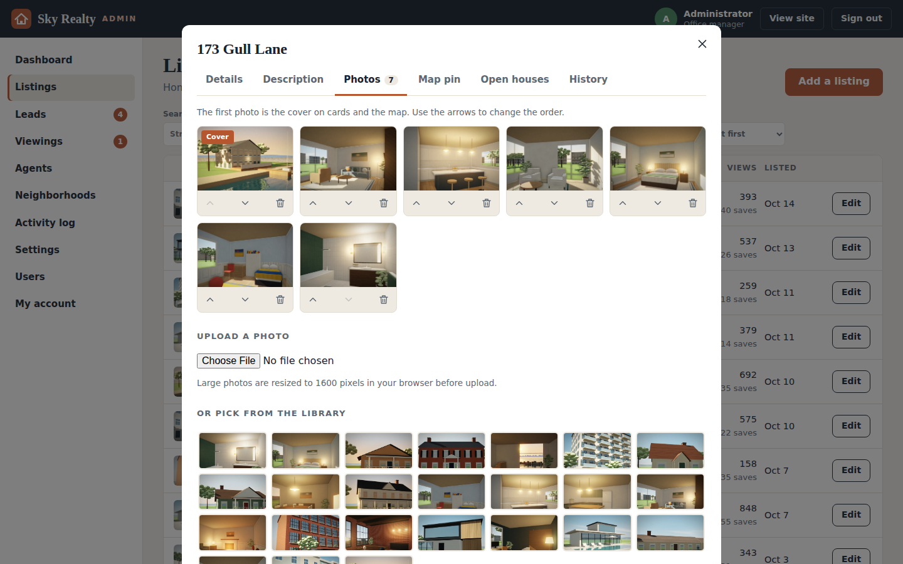

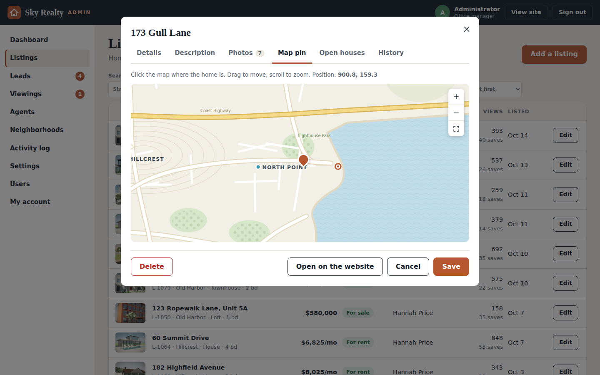

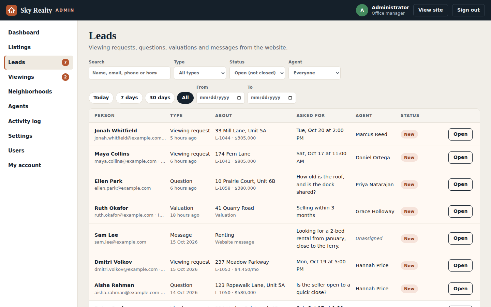

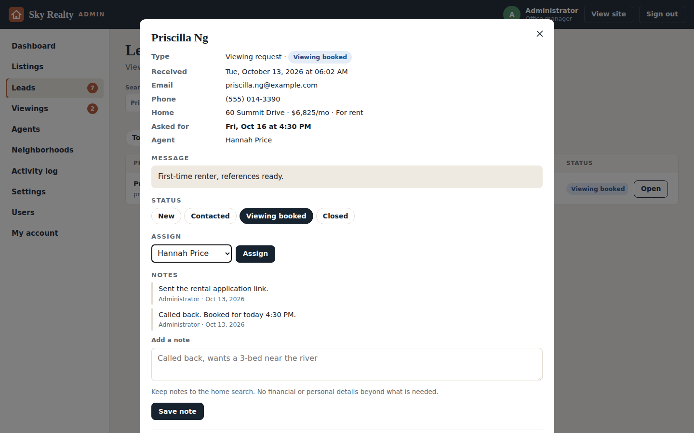

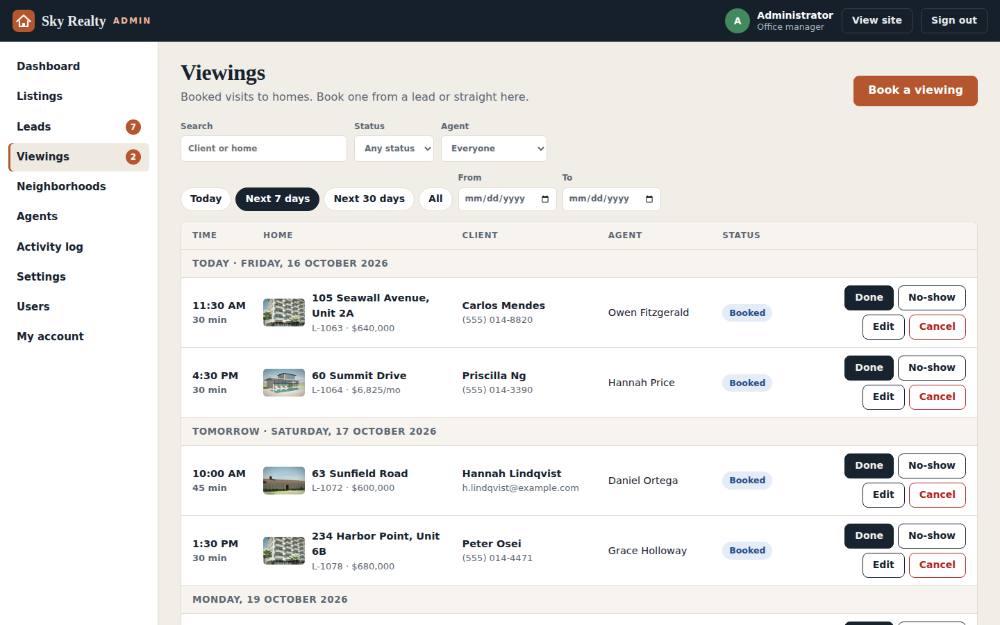

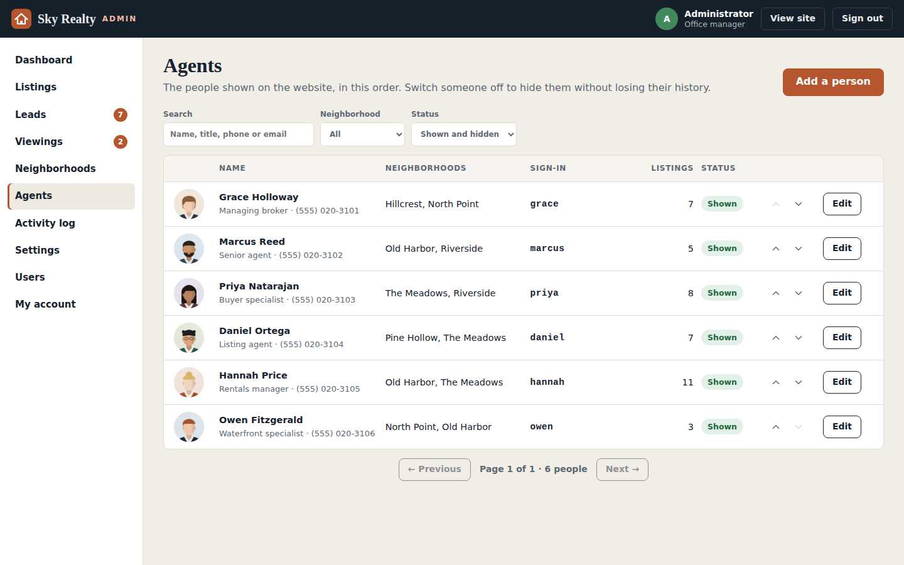

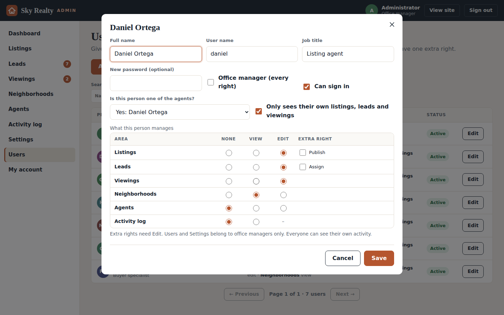

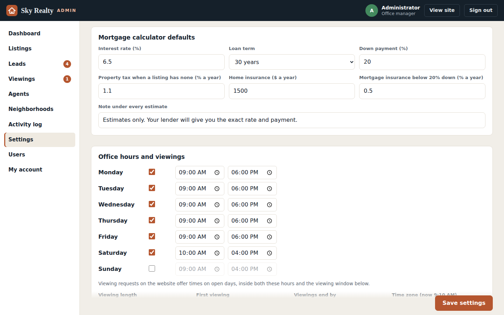

- **Painted photographs:** 25 scenes (12 house styles, 12 interiors and a street) rendered in code by Claude as 50 WebP files, plus 6 agent portraits.
- **In-house map:** the town of Ashby Harbor drawn as one SVG, with pins and labels laid over it by the page. No map service, no API key, no tracking.
- **No front-end build:** plain HTML, CSS and vanilla JavaScript; no npm, bundler or SPA framework.
- **No database:** everything lives in JSON files under `data/`.

---

## Getting started

**Requirements:** .NET 10 SDK and Visual Studio (or any editor with the `dotnet` CLI).

```bash
git clone https://github.com/hkim6000/SkyNet-RealEstateWebsite-Asp.net.Core-Full-Source.git
cd SkyNet-RealEstateWebsite-Asp.net.Core-Full-Source
dotnet run
```

Or open `RealEstate.csproj` in Visual Studio and press **F5**.
The SkyNet package (`TheSkyLite.SkyNet` 1.0.6) restores automatically from NuGet.
The app opens on **Home**, the startup page set in `appConfig/application.cfg`.

**Admin:** click **Staff sign in** in the footer (or open `/AdminLogin`) and press **Sign in**. See [Sign in](#sign-in).

**Dates:** the sample listings, leads and viewings carry dates relative to the day you first run the site, so "new" badges, open houses, today's viewings and days on the market look right. This happens once; after that dates stay as they are.

---

## Make it yours

1. **Settings:** name, town, address, phone, email, license line, accent colour, the word for your agents, website text, mortgage defaults, office hours, viewing window and time zone.
2. **Neighborhoods:** rename or replace the six areas, their colours, pictures and label positions.
3. **Agents:** add your people, photos, neighborhoods and bios.
4. **Listings:** replace the sample homes with your own. Upload photos, place the pin and publish.
5. **Sample leads and viewings:** delete them in the admin, or start from a `data/site.json` with empty `leads` and `viewings`.
6. **Map:** `images/map/ashby-harbor.svg` is the town map (1000 × 700 units, with a margin around it). Replace it with your own drawing of the same size, then move the pins and labels in the admin.
7. **Pictures:** uploads go to `images/uploads/full` (1600 px) and `images/uploads/thumbs` (640 px). The sample photos live in `images/homes/full` and `images/homes/thumbs`.

---

## Going live

1. **Change the sample passwords:** your own in My account, the agents' in Agents or Users. Remove the sample agents you don't need and add your team.
2. **Give the site write access** to these folders. On IIS, grant the application pool identity (for example `IIS AppPool\RealEstate`) **Modify** permission on:

   | Folder | What is written |
   |---|---|
   | `data/` | `site.json`, `staff.json`, `activity.json`, `subscribers.json` |
   | `images/uploads/` | uploaded photos |
   | `temp/` | staff sessions (`temp/admin`) |

3. **Block private files.** Open `https://<your-site>/data/staff.json` in a browser: it must answer 404. If your host serves it, block the `data/` folder in the server settings.
4. **Use HTTPS.** Session tokens travel in cookies and in each request.
5. **Never commit** your live `data/staff.json`, `data/activity.json`, `data/subscribers.json` or `temp/`.
6. **Check your local rules** for fair-housing wording, listing disclosures and storing client contact details.

> **Redeploying:** publishing copies the files in `data/` from your project over the live ones. Download the live `data/` folder first (or exclude it from the publish) so you keep your listings and leads. Turn off "Remove additional files at destination" so `temp/` and `images/uploads/` are not deleted.

Staff sessions last 8 hours and renew while you work. Changing a staff password signs that person out everywhere.

---

## Project structure

```
RealEstate/
├── appConfig/application.cfg        app settings
├── codes/
│   ├── Models/RealEstateModel.cs    data DTOs (Settings, Area, TeamMember, Property, Lead, Viewing, Staff, ...)
│   ├── Core/Store.cs                JSON storage, sample account, time zone, one-time date shift
│   ├── Core/Access.cs               areas and rights, passwords
│   ├── Core/Auth.cs                 staff sessions, admin menu
│   ├── Core/Calc.cs                 mortgage payment, schedule, affordability
│   ├── Core/Ui.cs                   shared HTML helpers, statuses, prices, period filter, paging
│   ├── Home.cs  Listings.cs  Listing.cs  Mortgage.cs  Agents.cs  Agent.cs  Sell.cs  Contact.cs
│   └── AdminLogin.cs  Admin.cs  AdminListings.cs  AdminLeads.cs  AdminViewings.cs
│       AdminAgents.cs  AdminAreas.cs  AdminSettings.cs  AdminUsers.cs  AdminActivity.cs  AdminAccount.cs
├── htmls/  scripts/  styles/        page markup, JavaScript and CSS
├── data/
│   ├── site.json                    settings, neighborhoods, agents, listings, leads, viewings
│   ├── staff.json                   users, password hashes and rights (sample office manager and agents)
│   ├── activity.json                the activity log (latest 5,000)
│   └── subscribers.json             new-listings email sign-ups
├── images/homes/full/  homes/thumbs/  painted photos (1600 px and 640 px, WebP)
├── images/agents/                   agent portraits (WebP)
├── images/map/ashby-harbor.svg      the town map
├── images/uploads/                  photos uploaded in the admin (created at run time)
├── temp/                            staff sessions (created at run time)
└── Program.cs
```

### One page = four files, one name

| File | Holds |
|---|---|
| `codes/Listings.cs` | the page class (`: WebPage`) and its server methods |
| `htmls/Listings.html` | markup with `{plhd_*}` placeholders |
| `scripts/Listings.js` | one IIFE namespace, `ListingsJs` |
| `styles/Listings.css` | styles, every class prefixed (`ls-`) |

---

## SkyNet in action

The browser calls a C# method, the method returns an `ApiResponse`, and only those parts of the page change.

```js
// scripts/Listings.js
call('Search', [{ key: 'fdeal', vlu: 'rent' }, { key: 'fbeds', vlu: '2' }, { key: 'fbx', vlu: '270,182,725,424' }]);
```

```csharp
// codes/Listings.cs
Filter f = Parse(site, k => Ui.Clip(GetDataValue("f" + k), 200));
Result r = Results(site, f, today);
response.SetElementContents("ls-cards", r.Cards);
response.SetElementContents("ls-pager", r.Pager);
response.ExecuteScript("ListingsJs.results(" + r.Pins + "," + r.Count + "," + r.Page + ");");
```

| Page | Requests |
|---|---|
| every public page | `Subscribe`, `Heart` |
| Listings | `Search` |
| Listing | `Pay`, `Send` |
| Home | `Quick` |
| Mortgage | `Figure`, `Afford` |
| Agent / Sell / Contact | `Send` |
| every admin page | `Load`, `SignOut` (AdminLogin: `SignIn`) |
| AdminListings | `List`, `Form`, `Save`, `Delete`, `Upload` |
| AdminLeads | `List`, `Open`, `SetStatus`, `Assign`, `AddNote`, `Delete` |
| AdminViewings | `List`, `Form`, `Save`, `Act` |
| AdminAgents / AdminAreas | `List`, `Form`, `Save`, `Move`, `Delete` (Agents: `Upload`) |
| AdminUsers / AdminSettings / AdminAccount / AdminActivity | `List`, `Form`, `Save` / `Save` / `Save` / `List` |

Learn more: [SkyNet Developer Guide](https://www.theskylite.com/documents/SkyNet_Developer_Guide.html)

---

## 100% AI-driven coding

Every file in this template was generated by Claude (Anthropic's AI) from short instructions, directed and reviewed by the author: C#, HTML, CSS, JavaScript, the painted photographs, the portraits, the map and the data.
No line was written by hand.

| | |
|---|---|
| Pages | 20 (8 public, 12 admin) |
| Lines of code | ~24,500 (C#, HTML, CSS, JavaScript) |
| Images | 25 painted scenes (50 WebP), 6 portraits and 1 SVG map |
| Neighborhoods / agents | 6 / 6 |
| Sample listings | 48 (36 for sale, 12 for rent) |
| Sample leads / viewings | 23 / 11 |
| Lines written by hand | 0 |

SkyNet's page model is small and predictable: one class, four files, `$ApiRequest` → `ApiResponse`.
With so few, consistent rules, AI can generate complete, working pages with very few errors.

---

## License

- **This template** (all source files, artwork and data in this repository): [MIT License](LICENSE). Free to use, modify and redistribute, including commercially.
- **SkyNet Framework** (`TheSkyLite.SkyNet` NuGet package): proprietary, free to use including commercial use; see the license included in the package.

---

## Links

- Live demo: https://www.theskylite.com/RealEstate
- SkyNet Framework: https://www.theskylite.com
- More website templates: https://www.theskylite.com/SkyNetTemp
- NuGet package: https://www.nuget.org/packages/TheSkyLite.SkyNet
- SkyNet Agent (build your own site with Claude Code): https://github.com/hkim6000/SkyNet-Agent
- Template #1 — Beauty store: https://github.com/hkim6000/SkyNet-BeautyWebsite-Asp.net.Core-Full-Source
- Template #2 — Pharma company: https://github.com/hkim6000/SkyNet-PharmaWebsite-Asp.net.Core-Full-Source
- Template #3 — Travel blog: https://github.com/hkim6000/SkyNet-TravelWebsite-Asp.net.Core-Full-Source
- Template #4 — Fast food restaurant: https://github.com/hkim6000/SkyNet-FastFoodWebsite-Asp.net.Core-Full-Source
- Template #5 — Fine dining restaurant: https://github.com/hkim6000/SkyNet-FineDiningWebsite-Asp.net.Core-Full-Source
- Template #6 — Car dealership: https://github.com/hkim6000/SkyNet-CarDealerWebsite-Asp.net.Core-Full-Source
- Template #7 — Web comic: https://github.com/hkim6000/SkyNet-WebComicWebsite-Asp.net.Core-Full-Source
- Template #8 — Art gallery: https://github.com/hkim6000/SkyNet-ArtGalleryWebsite-Asp.net.Core-Full-Source
- Template #9 — Artist blog: https://github.com/hkim6000/SkyNet-ArtistBlogWebsite-Asp.net.Core-Full-Source
- Template #10 — Newspaper: https://github.com/hkim6000/SkyNet-SkyLitePostWebsite-Asp.net.Core-Full-Source
- Template #11 — Hotel: https://github.com/hkim6000/SkyNet-SkyHotelWebsite-Asp.net.Core-Full-Source
- Template #12 — Clinic: https://github.com/hkim6000/SkyNet-ClinicWebsite-Asp.net.Core-Full-Source
- SkyNet project template: https://github.com/hkim6000/ASPNETCoreEmpty.SkyNet

© 2026 HC Kim
